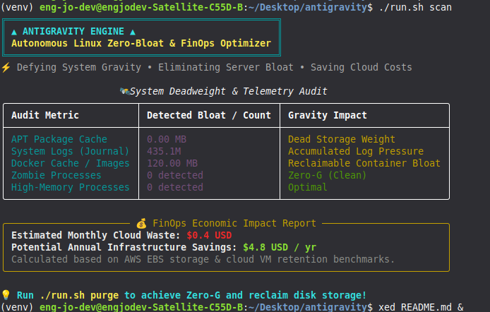

<div align="center">

# ▲ ANTIGRAVITY ▲
### Autonomous Linux Zero-Bloat, Deep Telemetry & FinOps Engine

> **Defy System Gravity • Slay Cloud Cost Waste • Reclaim Hardware Resources**

[](https://opensource.org/licenses/MIT)
[](https://www.python.org/)
[](https://kernel.org)
[](#-finops-economic-engine)
[](#)

<br/>

<p align="center">
  
</p>

*Live Terminal Telemetry: Real-time deadweight scanning, log pressure audit, and economic waste analysis.*

</div>

---

## 🌌 The Problem: The Invisible Weight of Production Systems

Modern Linux nodes and cloud VMs silently accumulate **deadweight**. Over weeks of operation, systems suffer from:

- **Unbounded Journal Bloat:** `systemd` logs ballooning into tens of gigabytes, consuming fast NVMe/SSD space.
- **Docker Layer Atrophy:** Dangling images, orphaned volume data, and untracked build cache.
- **Runaway Resource Pressure:** Memory leaks and zombie processes silently eating host capacity.
- **The FinOps Blindspot:** Companies routinely pay thousands of dollars every month for oversized cloud disks (AWS EBS, GCP Persistent Disks, Hetzner volumes) just to host abandoned cache and dead logs.

**Antigravity** breaks this cycle. It acts as an autonomous systems specialist that audits resource pressure, calculates financial liability in USD, and safely purges deadweight to restore **Zero-G performance**.

---

## ⚡ The Four Pillars of Antigravity
┌───────────────────────────────────────────────────────────────┐
│ ▲ ANTIGRAVITY CORE ▲ │
└───────┬───────────────────┬───────────────────┬───────────────┘
│ │ │
▼ ▼ ▼
[ Deadweight Audit ] [ FinOps Engine ] [ Safe Purge Engine ]
• APT Cache • Monthly Waste • Log Vacuuming (3d)
• Systemd Journals • Annual Loss ($) • APT Cache Flush
• Docker Build Cache • AWS EBS Formula • Process Reclaim
code
Code
### 1. 🛰️ System Deadweight Telemetry
Conducts sub-second inspection across host storage tiers:
- Scans package manager archives (`/var/cache/apt/archives`).
- Measures active `systemd` journal storage pressure.
- Queries Docker daemon storage (`docker system df`) for reclaimable build caches and untagged layers.

### 2. 💰 FinOps Economic Impact Calculator
Antigravity translates abstract byte counts into **boardroom metrics**:
- Models storage waste against standard **AWS EBS gp3 / SSD provisioned pricing** ($0.10 - $0.12 / GB-month).
- Projects **Monthly Dollar Waste** and **Potential Annual Infrastructure Savings**.
- Gives engineering leads concrete data to justify infrastructure right-sizing.

### 3. 🔍 Zombie & Memory Leak Hunter
- Iterates host process tables via non-blocking `/proc` telemetry.
- Identifies zombie processes (`STATUS_ZOMBIE`) locking OS process IDs.
- Flags memory-intensive processes exceeding safe thresholds.

### 4. 🧹 Sandboxed Zero-G Purge
- **Safety First:** Never touches source code, user directories, or running application databases.
- Intelligently vacuums journal logs to retain the last 3 days for forensic debugging.
- Cleans orphaned installation packages safely using system package manager hooks.

---

## 🚀 Quick Start (Under 60 Seconds)

### Prerequisites
- Any modern Linux distribution (Ubuntu, Debian, Linux Mint, Arch, Fedora, Rocky).
- Python 3.10 or higher.

### 1. Clone & Setup
```bash
git clone https://github.com/EngJoDev/antigravity.git
cd antigravity
chmod +x run.sh
2. Run Instant System Audit
code
Bash
./run.sh scan
3. Achieve Zero-Gravity (Safe Purge)
code
Bash
./run.sh purge
📊 Comparison: Vanilla Linux vs. With Antigravity
Feature	Standard Linux	With Antigravity
Deadweight Visibility	Manual du / df / htop	Single-command instant audit
Financial Insight (FinOps)	❌ None (Surprise cloud bill)	Direct USD waste projection
Journalctl Maintenance	Complex syntax & manual vacuum	One-click safe 3-day retention
Docker Cache Detection	Buried in verbose daemon CLI	Reclaimable MB calculated upfront
Dependencies	Requires complex monitoring stacks	Zero-overhead, pure Python CLI
🛡️ Safety & Reliability Policy
Antigravity adheres to strict SRE safety guidelines:
Zero Data Loss: It will never delete user files in /home, databases, or active configuration files.
Safe Log Preservation: Log vacuuming preserves the most recent 3 days of telemetry to ensure troubleshooting capability is never compromised.
Graceful Degradation: If Docker is not running or permissions are restricted, Antigravity logs findings safely without crashing.
🗺️ Roadmap

Initial release (v0.1.0) with Deadweight Scanner & FinOps calculator.

Automated Cron Daemon for scheduled weekly Zero-G purges.

AWS / GCP CloudWatch integration for multi-instance telemetry.

Slack / Discord webhook alerts for server bloat alerts.
🤝 Contributing
Contributions make open-source amazing. If you have an idea or optimization:
Fork the project.
Create your feature branch (git checkout -b feature/CoolFeature).
Commit your changes (git commit -m 'feat: Add CoolFeature').
Push to the branch (git push origin feature/CoolFeature).
Open a Pull Request.
👤 Author & Ecosystem
Crafted with passion for Linux systems and open-source infrastructure:
GitHub: @EngJoDev
Part of the Systems Suite: Check out GhostOps – Autonomous Linux SRE Copilot.

